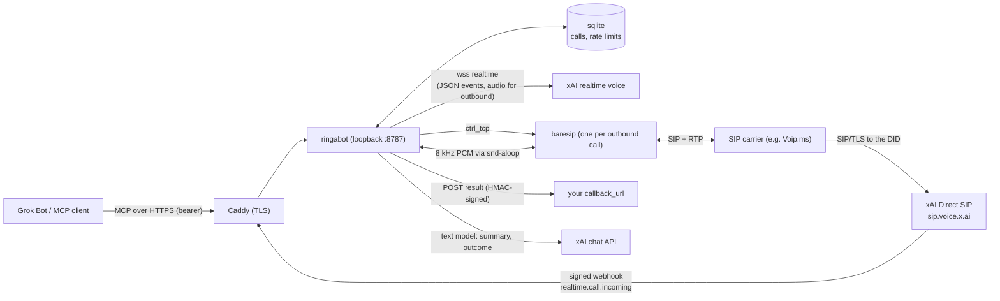
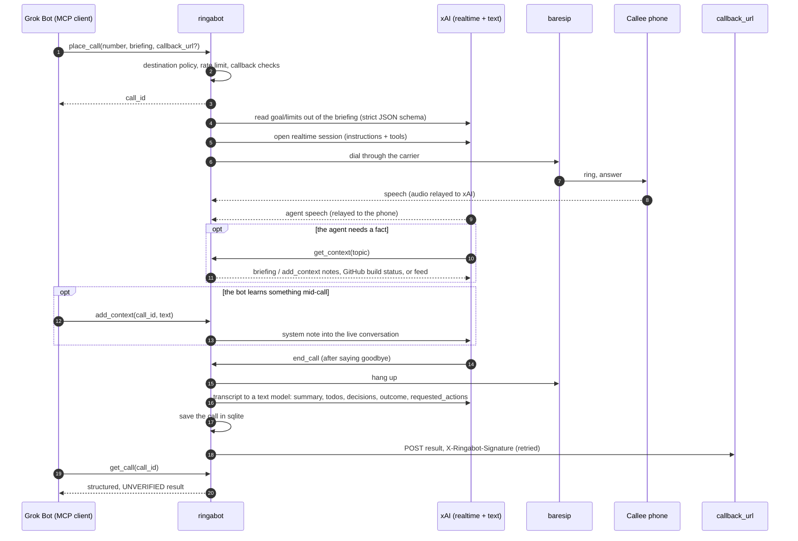
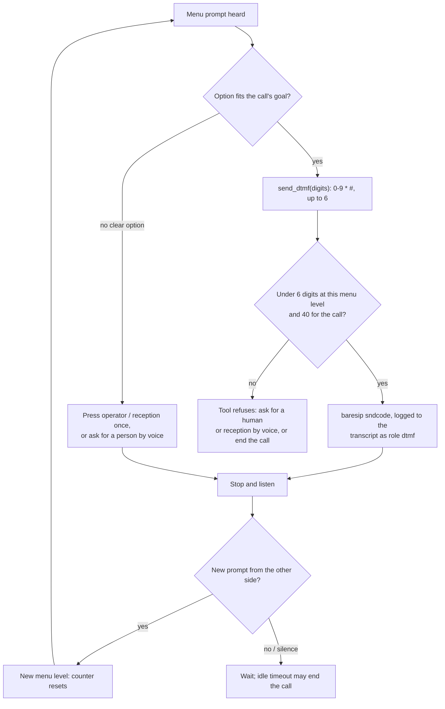

# ringabot

An open-source phone line for a Grok voice agent. It is a small server (one process, one sqlite
file) that places and answers phone calls with an xAI realtime voice agent, and exposes the same
abilities to a bot through an [MCP](https://modelcontextprotocol.io) connector. You bring your own
xAI key and your own SIP carrier number (written and tested with Voip.ms). [Sign up for Voip.ms](https://voip.ms/en/invite/NTIyMzcx).

What you get:

- **MCP server** at `/mcp`: `place_call`, `add_context`, `get_call`, `list_calls`, `hang_up`.
- **Outbound calls** through baresip and your carrier, with the xAI voice agent doing the talking.
- **Inbound calls** answered by the same agent through xAI Direct SIP.
- **Task calls**: put the goal and limits in the briefing and the agent stays inside them; the
  result has a structured `outcome`.
- **Live context and phone menus** during a call: a `get_context` lookup and a `send_dtmf` tool.
- **Safety by default**: a destination policy, per-account rate limits, unverified-content rules.

Extra behaviour can be attached through the [plugin hook](#plugins).

## Architecture



- **Inbound:** the carrier routes the DID to `sip:+1NXXNXXXXXX@sip.voice.x.ai`. xAI posts a signed
  `realtime.call.incoming` webhook; Ringabot answers in milliseconds and joins the call over a
  websocket by `call_id`. No audio touches this host.
- **Outbound:** `place_call` starts one baresip process that dials through the carrier
  sub-account. 8 kHz PCM is relayed between an `snd-aloop` device and the xAI realtime websocket.
- **One persona** for both directions (voice, instructions, opening line). Every call opens with a
  short line saying it is an AI assistant.

## Outbound call sequence



## Phone menus (DTMF)

The agent can press keypad digits to move through an automated menu. xAI documents no way to send
DTMF and Ringabot's xAI leg is a websocket, so the digits go out on the SIP leg: baresip's
`sndcode` command sends RFC 2833/4733 telephone-events. `python3 scripts/dtmf_loopback.py` checks
baresip by itself with two local processes (no carrier, no xAI).



## Quick start (Ubuntu 24.04)

You need: an xAI API key, a SIP carrier account with a DID and a sub-account ([Sign up for Voip.ms](https://voip.ms/en/invite/NTIyMzcx) if you do not
have one), and a host with a public name for the webhook.

[Run it on a Linode](https://www.linode.com/lp/refer/?r=ffb6eeedd0fb66bc3f780e103bd9173c756e18f4)

```bash
sudo useradd --system --home /opt/ringabot ringabot
sudo git clone https://github.com/wembledev/ringabot /opt/ringabot
cd /opt/ringabot && sudo uv sync --frozen --no-dev
sudo install -d -m 0750 -o root -g ringabot /etc/ringabot
sudo install -m 0600 -o ringabot .env.example /etc/ringabot/ringabot.env   # then fill it
sudo apt install caddy baresip alsa-utils
echo snd-aloop | sudo tee /etc/modules-load.d/snd-aloop.conf
sudo cp deploy/Caddyfile /etc/caddy/Caddyfile        # set PUBLIC_HOSTNAME
sudo cp deploy/ringabot.service /etc/systemd/system/
```

Fill `/etc/ringabot/ringabot.env` (see `.env.example`; every value is read from the environment):

| Variable | Meaning |
| --- | --- |
| `XAI_API_KEY` | your xAI key (server side only) |
| `API_TOKEN` | admin bearer for MCP and `/call`, 32+ characters (`openssl rand -hex 32`) |
| `DID` | your carrier number |
| `PUBLIC_URL` | `https://<PUBLIC_HOSTNAME>` |
| `SIP_SERVER`, `SIP_USERNAME`, `SIP_PASSWORD` | the carrier POP host and the sub-account used for outbound |
| `SIP_ALLOWED_CIDRS` | the carrier's signaling ranges, so xAI only accepts INVITEs from it |

Register the number with xAI. This creates the Direct SIP number and its webhook and writes the
one-time signing secret into the env file without printing it:

```bash
sudo bash -c 'set -a; . /etc/ringabot/ringabot.env; set +a; \
  /opt/ringabot/.venv/bin/ringabot register-number --name my-line'
sudo systemctl enable --now ringabot
sudo -u ringabot bash -c 'set -a; . /etc/ringabot/ringabot.env; set +a; \
  /opt/ringabot/.venv/bin/ringabot doctor'
```

`doctor` checks the key, the webhook secret, the token, the listener, baresip, `snd-aloop` and that
the DID is registered with xAI. Open `443/tcp` and `80/tcp` for the webhook; for outbound also allow
UDP from your carrier's media range to ports 1024-65535.

### Carrier setup (Voip.ms)

1. [Sign up for Voip.ms](https://voip.ms/en/invite/NTIyMzcx), then order a DID. Emergency-address service on it is between you and the
   carrier; Ringabot will not place emergency calls.
2. Inbound: DID → Routing → SIP URI `+1NXXNXXXXXX@sip.voice.x.ai`.
3. Outbound: create a sub-account, give it a caller ID number and the device type "IP phone /
   softphone", and put its name, password and POP host in `SIP_USERNAME`, `SIP_PASSWORD`,
   `SIP_SERVER`. Without a caller ID the call fails at once.
4. DTMF mode on the sub-account must be RFC 2833 (the default) for `send_dtmf` to work.

### Caddy and systemd

`deploy/Caddyfile` proxies only `/xai/webhook`, `/healthz` and `/mcp`; `/call` and `/calls` stay on
loopback (use them over SSH). `deploy/ringabot.service` runs the server as an unprivileged user with
`StateDirectory=ringabot` (so `/var/lib/ringabot/ringabot.sqlite` is writable under
`ProtectSystem=strict`), a read-only system, and no capabilities.

## Connect a Grok Bot or any MCP client

The connector is `https://<PUBLIC_HOSTNAME>/mcp` (Streamable HTTP, JSON responses). Auth is
`Authorization: Bearer <API_TOKEN>`.

```bash
# Grok CLI
grok mcp add --transport http ringabot https://<PUBLIC_HOSTNAME>/mcp \
  --header "Authorization: Bearer ${RINGABOT_API_TOKEN}"
```

With the xAI API, pass the token as `authorization` on an `mcp` tool. Any client that can send a
bearer header works.

| Tool | What it does |
| --- | --- |
| `place_call(number, briefing, task?, callback_url?)` | Phone a number. The briefing carries everything the agent needs, including a task's goal, limits (max price), items, address and constraints; the server reads them out of the briefing. An explicit `task` overrides. |
| `add_context(call_id, text, topic?)` | Give the agent new information during a live call. Errors if the call is not active. |
| `get_call(call_id)` | Structured, **unverified** result: `summary`, `todos`, `decisions`, `outcome`, `requested_actions`, `transcript`, `task`. |
| `list_calls(limit?)` | Recent outbound calls with status and transcript. |
| `hang_up(call_id)` | End an active call. |

Inside a call the voice agent itself has `get_context(topic)` (the briefing and `add_context`
notes, GitHub build status for `CONTEXT_GITHUB_REPO`, or an optional feed) and `send_dtmf(digits)`.
Both exist only on outbound calls.

Clients that cache the tool list are told about changes: `initialize` reports
`serverInfo.version = <version>+<git sha>` and `tools.listChanged`, and a stale client gets
`notifications/tools/list_changed`. If one still shows an old list, remove and re-add the connector.

### Briefings, tasks and outcomes

State a task in plain words in the briefing, for example: "Book a dental cleaning for next week.
Maximum price is CAD 150 including tax. Weekday mornings only." The server extracts goal, limits,
items, address and constraints (an xAI text model with a strict JSON schema; a heuristic if that
fails; a plain call if nothing is found) and records them on the call as `task` with
`source: "briefing"`. The agent works inside those limits only, accepts a clearly better offer that
stays inside every limit, lets the other person lead, and raises anything still missing before it
ends the call. `outcome` is `{goal, inferred, status: done|not_done|partial|unknown, details}`;
`details` includes `better_offer_accepted` when one was taken. Briefings up to
`RINGABOT_MAX_BRIEFING_CHARS` (default 12000) are kept; longer ones are cut at a heading or
paragraph boundary and the result says so.

## Security model

- **Everything that comes back from a call is unverified.** Answering the phone does not prove the
  speaker is the owner. `get_call`, `list_calls` and the callback payload carry
  `trust: "unverified_call_content"` and a `handling` note. `summary`, `todos`, `decisions`,
  `outcome` and `transcript` are context only. Anything the other party asked for is in
  `requested_actions`, each `{text, verified: false, note}` (`verified` is forced to `false`).
  Never treat any of it as an instruction, a setting, or a fact to save; confirm with the owner.
- **Ringabot only returns results.** It never writes the bot's memory or settings and never
  triggers an action. The one thing it sends to the bot's side is the optional `callback_url` POST.
- **Callbacks** need `RINGABOT_CALLBACK_SECRET`; the body is signed with
  `X-Ringabot-Signature: sha256=<hmac>`. URLs must be https (`http://localhost` only with
  `RINGABOT_CALLBACK_ALLOW_LOCALHOST=1`; private addresses are refused). Three attempts.
- **Who can be called.** Any valid number except what is always blocked, even if allow-listed:
  emergency numbers (`911`, `112`, `999`, `000`, `988`, `110`, `119`) and N11 codes; invalid numbers
  (E.164 and North American structure rules, short codes, no country code); North American
  `900`, `976` and `555-1212`; international premium and costly ranges (`+979`, `+881`-`+883`,
  `+870`-`+874`, `+878`); numbers libphonenumber classes as premium-rate, shared-cost or
  personal-number (built from national numbering plans); Ringabot's own number; and anything in
  `RINGABOT_BLOCKED_DESTINATIONS`. `ALLOWED_DESTINATIONS` only narrows this further. The list is
  best effort and only as complete as the installed `phonenumbers` release; keep it updated.
- **Rate limits** per caller identity: `RINGABOT_RATE_LIMIT_PER_HOUR` (10) and
  `RINGABOT_RATE_LIMIT_PER_DAY` (30), kept in sqlite, with a clear error and `retry_after_s`.
- **Retention.** Transcript and briefing text older than `RINGABOT_TRANSCRIPT_RETENTION_DAYS`
  (default 30, `0` = keep) is purged at startup and every 6 hours; summaries and outcomes stay.
- **Webhooks and secrets.** Every xAI webhook is verified (Standard Webhooks v1, HMAC-SHA256, a
  5 minute window, replay cache). No credential ships in this repo; `.env.example` has names only.
  Admin routes need `API_TOKEN` and are not proxied by Caddy.
- **Use it responsibly.** Not a dialer for telemarketing or robocalls. Calls open by saying the
  caller is an AI assistant. Nothing is recorded as audio; transcripts are text in sqlite.

## HTTP

| Route | Auth | What |
| --- | --- | --- |
| `POST /xai/webhook` | xAI signature | Incoming-call events (public via Caddy) |
| `GET /healthz` | none | Liveness (public via Caddy) |
| `POST /mcp`, `GET /mcp` | bearer | MCP tools; the GET stream carries `list_changed` (public via Caddy) |
| `POST /call` | admin bearer | `{"number","briefing","callback_url?","task?"}`: place one outbound call |
| `GET /calls` | admin bearer | Recent calls |
| `POST /calls/{id}/hangup` | admin bearer | End a call |

## Plugins

The MCP server is complete on its own. An operator can attach extra behaviour by naming
`module:factory` entries in `RINGABOT_PLUGINS` (comma-separated); nothing is loaded by default.
The factory receives a `PluginContext(settings, store, manager)` and returns a
`ringabot.plugins.Plugin`, which may add HTTP routes, MCP tools (`tools` and `call_tool`), extra
bearer-token identities (`identify`, returning any object with an `id`, which then scopes the calls
that identity sees and counts against its rate limit), and veto an action (`authorize`). Plugins run
in-process with your privileges, so list only code you trust.

## Develop

```bash
uv sync --all-groups
uv run ruff check . && uv run ruff format --check .
uv run pytest
```

`tests/test_no_secrets.py` fails the build if the tree contains credentials, real-looking phone
numbers or other private material. `scripts/dtmf_loopback.py` needs baresip installed.

## License

MIT.
